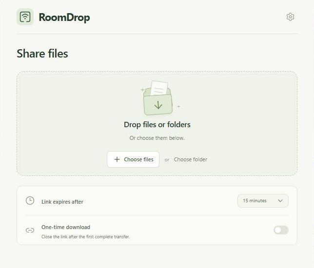

# RoomDrop

Share files over your local network.

RoomDrop is a small Wails 3 desktop utility for Windows, macOS, and Linux. Drop files or choose a folder, then let someone scan the QR code or open the local link in their browser. Files travel directly from your computer to theirs. The receiving device needs no installation.



## Sending files

1. Connect both devices to the same local network.
2. Choose a session lifetime: 5, 15, or 30 minutes, or 1 hour. Optionally enable **One-time download**.
3. Drop files or folders onto the drop zone, or use the native file picker. A sharing session starts automatically.
4. Share the QR code or use **Copy** to copy the full link. The recipient opens the page and chooses **Download**.
5. Watch real transfer progress in RoomDrop. Choose **Stop sharing** to revoke the link and cancel ongoing transfers. Closing the window also stops sharing and leaves RoomDrop in the system tray.

Single files download in their original format. Multiple files and folders are bundled into one ZIP, including empty directories. ZIP creation uses temporary disk space and can be cancelled. The temporary ZIP is removed when the session ends normally; a forced process termination or crash can leave a `roomdrop-*.zip` file in your OS temporary directory. Original files are never removed.

One-time sessions allow one active download. They close after the complete payload has been sent to the browser; opening or previewing the page does not consume the link. Failed transfers can be retried until the session expires. A completed transfer confirms bytes were sent to the browser, not that the recipient saved the file.

## System tray

RoomDrop adds its icon to the system tray while running. Click it to reopen the window, including when minimized. Right-click for **Open RoomDrop**, **Stop sharing**, and **Quit RoomDrop**. On Windows, the icon may appear in the tray overflow menu.

Closing the window stops sharing but keeps the tray icon available. **Quit RoomDrop** stops any transfers and exits the app.

## Local network notes

- Both devices must be able to reach one another. Guest Wi-Fi, client isolation, VPNs, and restrictive firewalls may prevent transfers. Allow RoomDrop through your firewall on **private networks** when appropriate.
- If you have several adapters, choose the correct address in Settings before starting a drop. RoomDrop remembers your selected adapter across restarts and follows its current IP address. If it is temporarily unavailable, an available adapter is selected without erasing your preference. RoomDrop binds only to that IPv4 adapter and a temporary OS-assigned port.
- Links contain a cryptographically random 256-bit token. Anyone with that link on the reachable local network can download. Keep it private.
- Transfers use local HTTP and are **not encrypted**. Use a trusted network. RoomDrop rejects public source addresses, but this does not authenticate devices or protect against an on-path observer.
- Keep RoomDrop open and the computer awake while sharing. Keep single source files unchanged during a session. Symbolic links and special files are rejected; choose their original files instead.
- Activity and selections are held only in memory. No database, accounts, external fonts, analytics, or cloud services are used.

## Develop

Requirements: Go 1.26+, Node.js 26+, npm, the Wails **3.1.0** CLI, and the [native prerequisites for your platform](https://v3.wails.io/getting-started/installation/). Windows requires WebView2. macOS requires the Xcode command line tools. Linux requires the Wails GTK/WebKit development dependencies.

```sh
go install github.com/wailsapp/wails/v3/cmd/wails3@v3.1.0
wails3 dev
```

Run these commands in the repository root. Wails installs frontend dependencies, generates Go bindings, and starts the native app with Vite hot reload.

For a production executable:

```sh
wails3 build
```

For a frontend-only view, first run `wails3 build` to generate bindings, then:

```sh
cd frontend
npm run dev
```

A plain browser displays the interface with sharing controls disabled. Real local transfers require the desktop app; the browser preview does not simulate a server or invent transfer activity.

The UI uses shadcn/ui with Base UI primitives. Its configuration is in `frontend/components.json`; theme colors and shadows live in `frontend/src/styles.css`. From `frontend/`, use `npx shadcn@latest add <component>` to add components, or `npx shadcn@latest add <component> --diff` to review upstream changes to an existing component.

## Checks

From the root:

```sh
go test . ./internal/...
go vet . ./internal/...
```

From `frontend/`, after generating bindings:

```sh
npm ci
npm run typecheck
npm test
npm run lint
npm run format:check
npm run build
```

The Go tests cover real HTTP downloads, one-time link previews and retries, concurrent requests, cancellation, expiration, request isolation, ZIP contents and cleanup, escaped filenames, symbolic links, and input validation.

The React tests cover native action ordering, cancellation, clipboard feedback, effect cleanup, and keyboard interaction. Network preference tests cover remembering adapters across restarts and address changes.

On Windows, after `wails3 build`, run `powershell -File scripts/test-uninstaller.ps1` to verify that uninstalling preserves unrelated files in an existing destination folder. The test uses an isolated installation and registry entry.

Full dependency notices are generated before frontend builds and can be read under **Settings → Open-source licenses**. Run `node scripts/generate-notices.mjs --check` to verify the checked-in notices.

Built from the [Wails React/TypeScript template](https://github.com/benjaminraffetseder/wails-react-ts-shadcn-template), using React, TypeScript, Base UI, Tailwind CSS, and Go. MIT licensed.
